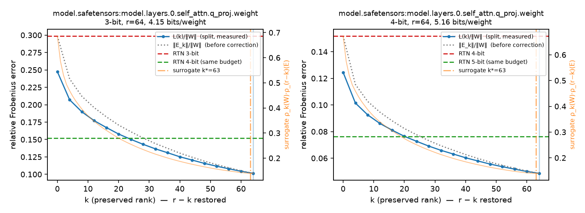

# lowbit-qer-lab — 저비트 양자화 오차를 저랭크로 얼마나 복원할 수 있나

[](https://github.com/mijnch/lowbit-qer-lab/actions/workflows/tests.yml)
[](LICENSE)


가중치 행렬 W를 저비트 정수 행렬 Q와 저랭크 항 LR의 합 **W ≈ Q + LR** 로 나타내는 방법을 numpy로
단순화해 구현하고, 작은 LLM 두 개의 실제 가중치에서 세 가지를 확인합니다.

1. **양자화한 뒤 오차를 복원**(QER: Q = Q_b(W), LR = SVD_r(W − Q))하는 것과, 랭크 예산 r을
   **먼저 보존할 k + 나중에 복원할 r − k** 로 나누는 것(보존-복원 분할) 중 어느 쪽이 언제 나은가.
2. 모든 k를 다 해 보지 않고 **대리지표** k* = argmin_k ρ_k(W)·ρ_(r−k)(E) 로 고른 k가 전수 탐색을
   얼마나 따라가는가.
3. 같은 비트 예산에서 "3비트 + 저랭크"가 "4비트 RTN"을 이기는가 — 가중치 오차(T1)와 perplexity(T2)에서.

> **논문 재현이 아닙니다.** Preserve-Then-Quantize(SRR, ICML 2026)·QERA·ODLRI(ACL 2025 Findings)의
> 문제의식을 따르되 양자화기(MXINT → RTN 그룹 128)·스케일(S → I)·대리지표의 탐침을 단순화했습니다.
> 차이는 [docs/notes.md](docs/notes.md)에 표로 적었습니다. 수치를 논문 표와 비교하면 안 됩니다.

> **코드와 문서는 AI 코딩 도구(Claude Code)가 작성했습니다.** 주제·범위·정직성 원칙은 제가 정했고,
> 구현·테스트·측정·본문은 제 요청에 따라 Claude Code가 수행했습니다. 모든 주장은 테스트(67개)와
> 다시 돌릴 수 있는 스크립트로 확인할 수 있게 했습니다.

## 결과

설정은 모두 같습니다: 그룹 128 비대칭 RTN, 랭크 r은 16비트 인자 기준 **가중치당 +1.0비트**
(2048×2048이면 r = 64, 576×576이면 r = 18), 오차는 ‖W − Ŵ‖_F/‖W‖_F. "같은 예산 RTN"은 한 비트 더 쓴
RTN(2048×2048에서 3비트 + r ≈ 4.15 bits/weight 대 4비트 RTN ≈ 4.16. 576폭 행렬은 그룹이 행마다 5개라
4.16 대 4.17).

### 1. 가중치 오차 (T1) — SmolLM2-135M, TinyLlama-1.1B

`scripts/t1_model_summary.py` (`results/t1_SmolLM2-135M.json`, `results/t1_TinyLlama-1.1B.json` — 명령은 아래 「재현 방법」).
SmolLM2-135M은 층 0·7·15·22·29, TinyLlama-1.1B(3T 기본 체크포인트)는 층 0·11의 선형층 7종 전부.
표는 3비트, 층 평균. ρ_r(W)는 W에서 상위 r개 성분을 빼고 남는 에너지 비율(작을수록 보존할 구조가 많다).

| SmolLM2-135M (층 5개 평균) | ρ_r(W) | RTN | QER (k=0) | 분할 최적 (k) | 같은 예산 4비트 RTN |
|---|---:|---:|---:|---:|---:|
| q_proj 576×576, r=18 | 0.64 | 0.232 | 0.210 | **0.177** (k=r) | 0.109 |
| k_proj 192×576, r=9 | 0.70 | 0.229 | 0.208 | 0.188 (k=r) | 0.108 |
| o_proj 576×576, r=18 | 0.75 | 0.233 | 0.214 | 0.191 (k=r) | 0.109 |
| gate_proj 1536×576, r=26 | 0.83 | 0.222 | 0.207 | 0.200 | 0.104 |
| down_proj 576×1536, r=26 | 0.84 | 0.229 | 0.211 | 0.207 | 0.107 |
| v_proj 192×576, r=9 | 0.87 | 0.229 | 0.215 | 0.212 | 0.108 |
| up_proj 1536×576, r=26 | 0.87 | 0.220 | 0.207 | 0.205 | 0.103 |

| TinyLlama-1.1B | ρ_r(W) | RTN | QER (k=0) | 분할 최적 (k) | 같은 예산 4비트 RTN |
|---|---:|---:|---:|---:|---:|
| **층 0** q_proj 2048×2048, r=64 | **0.14** | 0.299 | 0.247 | **0.101** (k=r) | 0.152 |
| **층 0** k_proj 256×2048, r=14 | **0.18** | 0.311 | 0.256 | **0.128** (k=r) | 0.164 |
| 층 0 o_proj 2048×2048, r=64 | 0.59 | 0.238 | 0.199 | 0.175 (k=r) | 0.113 |
| 층 0 gate_proj 5632×2048, r=93 | 0.74 | 0.226 | 0.212 | 0.186 (k=r) | 0.105 |
| 층 11 q_proj | 0.66 | 0.226 | 0.205 | 0.184 (k=r) | 0.106 |
| 층 11 o_proj | 0.77 | 0.222 | 0.208 | 0.193 (k=r) | 0.104 |
| 층 11 k/v/gate/up/down | 0.81~0.86 | 0.219~0.223 | 0.206~0.211 | 0.197~0.206 | 0.102~0.105 |



읽는 법 (자세한 것은 [docs/notes.md](docs/notes.md)):

- **분할의 이득은 ρ_r(W) 하나로 거의 결정됩니다.** QER 대비 분할의 오차 감소율과 ρ_r(W)의 상관이
  SmolLM2 −0.97, TinyLlama −0.98입니다. ρ_r이 0.14~0.37인 첫 층 q/k에서는 오차가 30~61% 줄고
  (TinyLlama 층 0 q_proj: 0.247 → 0.101), ρ_r ≥ 0.8인 v/up/down에서는 0~4.4%로 QER과 거의 같습니다.
- **최적 k는 거의 항상 k = r — 전부 보존하고 복원은 하지 않는 쪽입니다.** TinyLlama 28/28행,
  SmolLM2 70행 중 44행(51행은 k ≥ 0.9r). 양자화 잔차 E_k의 스펙트럼이 백색잡음에 가까워서
  랭크 r−k의 복원 항이 걷어 내는 에너지가 (r−k)/min(m,n) 수준에 그치기 때문입니다. 이 설정(S = I)에서는
  "양자화 뒤 복원"보다 "양자화 전 보존"이 예산을 훨씬 잘 씁니다.
- **대리지표의 후회는 SmolLM2 ≤1.9%, TinyLlama ≤3.9%**(층 0 o_proj에서 k* 41~42 대 최적 64).
  고른 k*가 다를 때도 손실 곡선이 그 구간에서 평평해 차이가 작습니다.
- **같은 비트 예산에서는 대개 4비트 RTN이 이깁니다**(가중치 오차 기준). 분할이 이긴 곳은 TinyLlama
  층 0의 q_proj·k_proj(0.101 대 0.152, 0.128 대 0.164)뿐이고, SmolLM2에서는 한 곳도 없습니다
  (0.18~0.21 대 0.10~0.11). 가중치 오차와 모델 출력은 다른 이야기라 — [int8-quant-lab의
  분석](https://github.com/mijnch/int8-quant-lab/blob/main/docs/analysis_4bit.md)에서 가중치 MSE가 정확도를
  예측하지 못했듯 — T2에서 다시 봅니다.

### 2. perplexity (T2) — SmolLM2-135M, WikiText-2

`python scripts/t2_perplexity.py --model models/SmolLM2-135M --max-windows 40` (`results/t2_SmolLM2-135M.json`).
디코더의 선형층 210개 전부를 바꾸고, WikiText-2 테스트 분할을 이어 붙여 앞 40창 × 1024 토큰(약 41k 토큰,
분할 전체의 13%)에서 perplexity = exp(토큰당 평균 NLL). 분할의 k는 대리지표 k*(층마다 다르며 평균 16).

| SmolLM2-135M | bits/weight | 가중치 오차 (층 RMS) | **perplexity** |
|---|---:|---:|---:|
| fp32 | 16 | 0 | **16.81** |
| RTN 3비트 | 3.16 | 0.224 | 127.4 |
| QER 3비트 + r | 4.16 | 0.208 | **80.9** |
| 분할 3비트 + r (k*) | 4.16 | **0.203** | 121.1 |
| 분할 3비트 + r (ρ 규칙: 2개만 보존) | 4.16 | 0.208 | 81.0 |
| RTN 4비트 — 같은 예산 | 4.17 | 0.104 | **22.7** |
| QER 4비트 + r | 5.16 | 0.097 | **21.7** |
| 분할 4비트 + r (k*) | 5.16 | **0.095** | 22.7 |
| RTN 5비트 — 같은 예산 | 5.18 | 0.051 | **18.1** |

- **같은 예산에서는 perplexity에서도 "한 비트 더"가 이깁니다.** 4비트 RTN 22.7 대 3비트 + 랭크 80.9/121.1,
  5비트 RTN 18.1 대 4비트 + 랭크 21.7/22.7. 이 크기의 모델에서는 저랭크 항에 1비트를 쓰는 것보다 정수에
  쓰는 편이 낫습니다(T1의 프로베니우스 결론과 같음).
- **가중치 오차와 perplexity의 순위가 뒤집힙니다.** 분할이 가중치 오차는 더 낮은데(0.203 대 0.208),
  perplexity는 QER이 훨씬 낫습니다(3비트 80.9 대 121.1, 4비트 21.7 대 22.7). 층 하나씩 실제 활성값 X로 잰
  출력 오차 ‖X(W − Ŵ)ᵀ‖/‖XWᵀ‖ 로도 분할이 QER보다 낮습니다(`scripts/t2_output_error.py`, 층 0·15·29의
  21개 행렬 중 17개, 1개는 k* = 0이라 QER과 같음). 즉 **행렬 하나의 오차(가중치든 출력이든)로는 210개 층을 동시에 바꿨을 때의
  perplexity를 예측할 수 없고**, 층 사이의 누적·전파가 결과를 정합니다 — int8-quant-lab에서 특정 층의
  오차만 뒤쪽 망에서 증폭되던 것과 같은 종류의 현상입니다.
- **차이는 MLP에서 납니다.** 3비트 QER 대 분할을 층 일부에만 적용하면(`--layers`): 층 0만 17.59 대
  17.51(분할이 근소하게 나음), 어텐션 120개만 26.12 대 26.46, **MLP 90개만 38.93 대 47.58**, 전부 80.9 대
  121.1. ρ_r(W)가 낮은 첫 층 q/k(0.30·0.37)는 "보존"이 perplexity에서도 이기고, ρ_r이 0.8 이상인
  gate/up/down에서는 가중치 오차로는 분할이 근소하게 나아도 perplexity는 "복원"(QER)이 훨씬 낫습니다.
  즉 가중치 오차로 고른 k(거의 항상 k = r)는 ρ_r이 높은 층에서 틀린 선택입니다.
  그 규칙을 그대로 적용하면(`--k rho`: ρ_r < 0.5이면 전부 보존, 아니면 QER) 210개 중 2개(층 0 q/k)만
  보존되고 perplexity는 81.0 — QER(80.9)과 같습니다. 이 모델에서 "보존"이 perplexity에 주는 이득은 층 0에서도
  작고(17.51 대 17.59), "복원"을 포기한 대가는 큽니다.
  왜 복원 항이 — 걷어내는 오차 에너지가 r/min(m,n)뿐인데도 — 누적에 강한지는 열린 질문입니다(docs/notes.md).

### 3. 합성 행렬 — 파이프라인 점검

실제 가중치를 받기 전에 구조가 다른 합성 행렬 4종(1024×1024, 시드 3개, r = 32)으로 돌린 것입니다.
`python scripts/t1_summary.py` (`results/t1_synthetic_summary.json`). 3비트, 시드 평균.

| 행렬 (1024×1024) | ρ_32(W) | RTN | QER (k=0) | 분할 최적 | 분할 대리 k* | 대리 후회 | 같은 예산 4비트 RTN |
|---|---:|---:|---:|---:|---:|---:|---:|
| iid 가우스 | 0.89 | 0.216 | 0.203 | 0.203 | 0.203 | ≤0.08% | **0.101** |
| 완만히 감소하는 스펙트럼 | 0.75 | 0.216 | 0.203 | 0.187 | 0.187 | ≤0.08% | **0.101** |
| 랭크 16 성분 + 잡음 | 0.55 | 0.215 | 0.203 | 0.160 | 0.160 | ≤0.13% | **0.101** |
| 이상치 채널 8개 (10배) | 0.51 | 0.346 | 0.316 | **0.154** | **0.154** (k*=8) | ≤0.21% | 0.178 |

실제 가중치에서 본 규칙이 여기서도 같습니다 — 이득은 ρ_r(W)가 작을 때만, 대리지표 후회는 작고,
같은 예산에서는 이상치 행렬에서만 분할이 이깁니다. 이상치 채널 8개를 k = 8로 먼저 보존하면 그룹 scale이
줄어 양자화 오차 자체가 0.35 → 0.16이 되고(그림 `results/figures/t1_synthetic_outlier_1024x1024_0.png`),
대리지표가 정확히 k* = 8을 고릅니다.

## 측정한 것 / 측정하지 않은 것

| 측정함 | 측정하지 않음 |
|---|---|
| 실제 가중치 T1: SmolLM2-135M 층 5개, TinyLlama-1.1B 층 2개, 선형층 7종 × 3·4비트 (98행) | 두 모델의 나머지 층, 더 큰 모델 — TinyLlama는 층 0·11만, k는 8 간격으로 잼 |
| perplexity T2: SmolLM2-135M, WikiText-2 테스트 분할 **앞 40창 × 1024 토큰**(약 41k 토큰) · 층 출력 오차(실제 활성값 4창, 층 0·15·29) | 테스트 분할 전체(297창), TinyLlama의 perplexity(CPU 시간), 분할의 k를 전수 탐색으로 고른 perplexity |
| 합성 행렬 4종 × 시드 3개, 대리지표의 후회(전수 탐색 대비) | 활성값 스케일 S ≠ I, MXINT 양자화기, 학습(QPEFT, T3), 과제 정확도 |
| Eckart–Young, k = 0 ↔ QER 일치, 양 끝값, RTN 오차 한계·그룹 독립성, 비트 예산, safetensors 읽기 (테스트 67개) | 지연시간·메모리 — 전부 fake quantization(역양자화한 float)으로 잰 것 |

## 방법 (기호)

W ∈ ℝ^(m×n), Q_b(·) = b비트 RTN(그룹 128, 비대칭), SVD_p(A) = A의 상위 p개 특이성분, ρ_p(A) = ‖A − SVD_p(A)‖²_F / ‖A‖²_F.

```
QER     Ŵ = Q + SVD_r(W − Q),  Q = Q_b(W)
분할    P_k = SVD_k(W),  Q_k = Q_b(W − P_k),  E_k = W − P_k − Q_k,  C_k = SVD_(r−k)(E_k)
        Ŵ(k) = P_k + Q_k + C_k,   L(k) = ‖W − Ŵ(k)‖_F = ‖E_k − C_k‖_F     (k = 0 이면 QER)
대리    k* = argmin_k ρ_k(W)·ρ_(r−k)(E_probe),  E_probe = W − Q_b(W)
예산    가중치당 비트 = b + (16 + b)/128 + 16·r·(m+n)/(m·n)     2048×2048, r=64 → +1.0비트
```

저장 비용은 k와 무관합니다(저랭크 인자는 합쳐서 랭크 r, 정수 행렬은 하나). Eckart–Young 정리로
‖E_k − SVD_(r−k)(E_k)‖²_F = Σ_(i>r−k) σ_i(E_k)² 이므로 곡선은 특이값만으로 계산합니다.

## 재현 방법

```bash
pip install -r requirements.txt
pytest -q                                                            # 67개
python scripts/t1_summary.py --seeds 0 1 2                           # 합성 행렬 표 (약 3분)

# 실제 가중치 — safetensors 파일을 받아 둔다 (models/ 는 .gitignore)
mkdir -p models/SmolLM2-135M && curl -L -o models/SmolLM2-135M/model.safetensors \
  https://huggingface.co/HuggingFaceTB/SmolLM2-135M/resolve/main/model.safetensors
python scripts/t1_model_summary.py --file models/SmolLM2-135M/model.safetensors --tag SmolLM2-135M --layers 0 7 15 22 29
python scripts/t1_model_summary.py --file models/TinyLlama-1.1B-3T/model.safetensors --tag TinyLlama-1.1B --layers 0 11 --k-step 8
python scripts/t1_layer_curve.py --weight models/TinyLlama-1.1B-3T/model.safetensors:model.layers.0.self_attn.q_proj.weight --k-step 4 --name TinyLlama-1.1B_L0_q_proj
python scripts/t1_layer_curve.py --weight models/SmolLM2-135M/model.safetensors:model.layers.15.self_attn.q_proj.weight --name SmolLM2-135M_L15_q_proj

# perplexity — torch·transformers·datasets 필요. --model 에는 config·tokenizer까지 받아 둔 디렉터리나 HF 이름
pip install -r requirements-llm.txt
# 이 저장소의 T2 결과는 torch 2.14.1+cpu · transformers 5.20.1 · datasets 5.1.0 · Python 3.11.15, CPU 4개(GPU 없음)에서 만들었다
python scripts/t2_perplexity.py --model models/SmolLM2-135M --methods fp rtn qer split --bits 3 4 --max-windows 40
```

torch 없이도 T1은 돕니다(`scripts/_common.read_safetensor`가 bf16까지 직접 읽음). TinyLlama 체크포인트는
`TinyLlama/TinyLlama-1.1B-intermediate-step-1431k-3T`(4.4 GB, fp32)입니다.

## 구조

```
qer/
  quant.py     RTN 그룹 양자화기 (비대칭/대칭)
  lowrank.py   SVD_p, ρ_p 곡선, Eckart–Young 검산
  split.py     보존-복원 분할, L(k) 곡선(특이값만으로), 대리지표
  budget.py    가중치당 비트, 예산 → 랭크
  apply.py     행렬 하나를 fp/rtn/qer/split 로 압축 (T2에서 층마다 호출)
  synth.py     합성 행렬 4종
scripts/
  t1_layer_curve.py     행렬 하나의 곡선·그림 (--k-step: 큰 행렬은 k를 띄엄띄엄)
  t1_model_summary.py   safetensors의 여러 층·행렬 요약 표 (행마다 저장)
  t1_summary.py         합성 4종 × 시드 요약 표
  t2_perplexity.py      모든 디코더 선형층 + WikiText-2 perplexity (--layers 정규식으로 일부 층만도 가능)
  t2_output_error.py    실제 활성값으로 층 하나의 출력 오차 ‖X(W − Ŵ)ᵀ‖/‖XWᵀ‖
  _common.py            safetensors 읽기(torch 불필요, bf16 포함), 결과 저장
tests/        67개
results/      t1_*.json, t2_*.json, figures/
docs/notes.md 논문과 다른 점, 막힌 곳, 관찰, 열린 질문
```

## 다음 단계

1. 활성값 스케일 S ≠ I — 보정 데이터로 입력 채널 통계를 모아 ‖(W − Ŵ)S‖로 k를 고르면 "k = r"이
   유지되는지(QERA·ODLRI가 S를 쓰는 이유가 여기서 드러나야 한다).
2. 두 모델의 모든 층과 테스트 분할 전체로 T1·T2 — 결론이 층 표본에 기댄 것이 아닌지.
3. T3 — Q를 고정하고 L·R만 짧게 학습(QPEFT 축소판).

## 라이선스

MIT (LICENSE).

<details>
<summary>English summary</summary>

**lowbit-qer-lab** is a NumPy study of low-bit weight quantization with low-rank error
reconstruction, W ≈ Q + LR, on real weights of two small LLMs (SmolLM2-135M, TinyLlama-1.1B). It
compares plain QER (quantize, then fit SVD_r to the residual) with a preserve-then-quantize split of
the rank budget (keep the top-k components in float before quantizing, restore r−k afterwards), checks
how well a cheap surrogate k* = argmin ρ_k(W)·ρ_(r−k)(E) tracks an exhaustive search over k, and
compares "3-bit + rank r" against "4-bit RTN" at equal bits per weight.

It is **not a reproduction** of SRR (ICML 2026), QERA or ODLRI (ACL 2025 Findings): the quantizer is
asymmetric group-128 RTN instead of MXINT, the activation scale S is the identity, and the surrogate's
probe matrix is this repository's choice.

Findings (Frobenius error, 98 rows: 49 real matrices × 3/4-bit): the gain of the split over QER is almost entirely
determined by ρ_r(W), the energy left after removing W's top r components (correlation −0.97/−0.98);
first-layer q/k projections are strongly low-rank (ρ_64 = 0.14 for TinyLlama layer 0 q_proj) and there
the 3-bit error drops 0.247 → 0.101, below 4-bit RTN at the same budget (0.152), while v/up/down with
ρ_r ≥ 0.8 gain nothing. The optimum is k = r in 72 of 98 rows — preserve everything, restore nothing —
because the quantization residual is spectrally white. Surrogate regret ≤ 1.9% (SmolLM2) and ≤ 3.9%
(TinyLlama). At equal bits per weight, plain 4-bit RTN wins everywhere except TinyLlama layer-0 q/k.
Perplexity (T2, WikiText-2, SmolLM2-135M) is reported in the Korean section above.
67 tests cover Eckart–Young, k = 0 ↔ QER, RTN error bounds, the bit budget and a torch-free
safetensors reader (bf16 included).

Code and documentation were written by an AI coding assistant (Claude Code) at the author's request;
the topic, scope and honesty rules are the author's.

</details>
