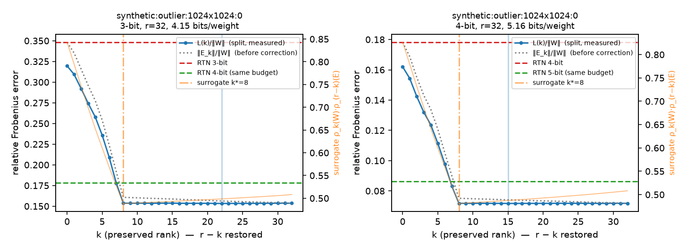

# lowbit-qer-lab — 저비트 양자화 오차를 저랭크로 얼마나 복원할 수 있나

[](https://github.com/mijnch/lowbit-qer-lab/actions/workflows/tests.yml)
[](LICENSE)

가중치 행렬 W를 저비트 정수 행렬 Q와 저랭크 항 LR의 합 **W ≈ Q + LR** 로 나타내는 방법을 numpy로
단순화해 구현하고, 두 가지를 확인합니다.

1. **양자화한 뒤 오차를 복원**(QER: Q = Q_b(W), LR = SVD_r(W − Q))하는 것과, 랭크 예산 r을
   **먼저 보존할 k + 나중에 복원할 r − k** 로 나누는 것(보존-복원 분할) 중 어느 쪽이 언제 나은가.
2. 모든 k를 다 해 보지 않고 **대리지표** k* = argmin_k ρ_k(W)·ρ_(r−k)(E) 로 고른 k가 전수 탐색을
   얼마나 따라가는가.

> **논문 재현이 아닙니다.** Preserve-Then-Quantize(SRR, ICML 2026)·QERA·ODLRI(ACL 2025 Findings)의
> 문제의식을 따르되 양자화기(MXINT → RTN 그룹 128)·스케일(S → I)·대리지표의 탐침을 단순화했습니다.
> 차이는 [docs/notes.md](docs/notes.md)에 표로 적었습니다. 수치를 논문 표와 비교하면 안 됩니다.

> **코드와 문서는 AI 코딩 도구(Claude Code)가 작성했습니다.** 주제·범위·정직성 원칙은 제가 정했고,
> 구현·테스트·측정·본문은 제 요청에 따라 Claude Code가 수행했습니다. 모든 주장은 테스트(58개)와
> 다시 돌릴 수 있는 스크립트로 확인할 수 있게 했습니다.

## 지금까지의 결과 — 합성 행렬 (실제 LLM 가중치는 아직 아님)

이 저장소를 만든 환경에서는 모델 허브에 접근할 수 없어, 구조가 다른 합성 행렬 4종(1024×1024, 시드 3개)
으로 파이프라인을 확인했습니다. 상대 프로베니우스 오차 ‖W − Ŵ‖_F/‖W‖_F, 그룹 128 비대칭 RTN,
랭크 r = 32(16비트 인자 기준 가중치당 +1.0비트). `python scripts/t1_summary.py`.

| 행렬 (1024×1024) | 비트 | RTN | QER (k=0) | 분할 최적 k | 분할 대리 k* | 대리 후회 | 같은 예산 RTN |
|---|---:|---:|---:|---:|---:|---:|---:|
| iid 가우스 | 3 | 0.216 | 0.203 | 0.203 | 0.203 | ≤0.08% | **0.101** (4비트) |
| 완만히 감소하는 스펙트럼 | 3 | 0.216 | 0.203 | 0.187 (k≈30) | 0.187 | ≤0.08% | **0.101** (4비트) |
| 랭크 16 성분 + 잡음 | 3 | 0.215 | 0.203 | 0.160 (k=17~26) | 0.160 | ≤0.13% | **0.101** (4비트) |
| 이상치 채널 8개 (10배) | 3 | 0.346 | 0.316 | **0.154** (k=22~31) | **0.154** (k*=8) | ≤0.21% | 0.178 (4비트) |
| iid 가우스 | 4 | 0.101 | 0.095 | 0.095 | 0.095 | ≤0.12% | **0.049** (5비트) |
| 완만히 감소하는 스펙트럼 | 4 | 0.101 | 0.095 | 0.087 | 0.087 | ≤0.12% | **0.049** (5비트) |
| 랭크 16 성분 + 잡음 | 4 | 0.101 | 0.095 | 0.075 (k≈31) | 0.075 | ≤0.16% | **0.049** (5비트) |
| 이상치 채널 8개 (10배) | 4 | 0.178 | 0.161 | **0.072** (k=15~18) | **0.072** (k*=8) | ≤0.19% | 0.087 (5비트) |

읽는 법 (자세한 것은 [docs/notes.md](docs/notes.md)):

- **보존(k > 0)의 이득은 W에 보존할 구조가 있을 때만 생깁니다.** iid 가우스에서는 어떤 k도 QER과
  같고, 저랭크 성분·이상치 채널이 있으면 3비트 오차가 0.203 → 0.160, 0.316 → 0.154로 줍니다.
- **이상치 채널은 먼저 떼어 두는 쪽이 압도적입니다.** 열 8개가 10배 큰 행렬에서 k = 8로 그 성분을
  보존하면 그룹 scale이 줄어 양자화 오차 자체가 0.35 → 0.16이 되고, 이후 복원 항은 거의 할 일이 없습니다
  (k ≥ 8에서 곡선이 평평). 대리지표는 정확히 k* = 8을 고릅니다.
  
- **대리지표의 후회는 0.21% 이하입니다.** 고른 k*가 최적 k와 다를 때도 많지만 그 구간에서 손실 곡선이
  평평합니다.
- **같은 비트 예산에서는 대개 "한 비트 더 쓰는 RTN"이 이깁니다**(프로베니우스 기준). 3비트 + 랭크 32
  (≈4.15 bits/weight) 대 4비트 RTN(≈4.16)에서 분할이 이기는 것은 이상치 행렬뿐입니다. 이 비교는
  가중치 오차 기준이라, 활성값 가중이나 perplexity에서는 달라질 수 있습니다 —
  [int8-quant-lab의 분석](https://github.com/mijnch/int8-quant-lab/blob/main/docs/analysis_4bit.md)에서
  가중치 MSE가 정확도를 예측하지 못했던 것과 같은 이유입니다. 그래서 T2가 필요합니다.

## 측정한 것 / 측정하지 않은 것

| 측정함 | 측정하지 않음 |
|---|---|
| 합성 행렬 4종 × 시드 3개 × 3·4비트에서 RTN / QER / 분할(전수·대리) 상대 오차, 같은 예산 RTN | **실제 LLM 가중치** — 모델 허브가 막힌 환경이라 받지 못함. `scripts/_common.read_safetensor`(torch 불필요, bf16 포함, 테스트 있음)로 파일만 있으면 바로 T1 가능 |
| Eckart–Young, k = 0 ↔ QER 일치, 양 끝값, RTN 오차 한계·그룹 독립성, 비트 예산 공식 (테스트 58개) | **perplexity(T2)** — `scripts/t2_perplexity.py`는 작성했으나 **이 환경에서 실행하지 못했음**(torch 미설치). numpy 부분은 테스트, torch 연결은 미확인 |
| 대리지표의 후회(전수 탐색 대비) | 활성값 스케일 S ≠ I, MXINT 양자화기, 학습(QPEFT, T3) |

## 방법 (기호)

W ∈ ℝ^(m×n), Q_b(·) = b비트 RTN(그룹 128, 비대칭), SVD_p(A) = A의 상위 p개 특이성분, ρ_p(A) = ‖A − SVD_p(A)‖²_F / ‖A‖²_F.

```
QER     Ŵ = Q + SVD_r(W − Q),  Q = Q_b(W)
분할    P_k = SVD_k(W),  Q_k = Q_b(W − P_k),  E_k = W − P_k − Q_k,  C_k = SVD_(r−k)(E_k)
        Ŵ(k) = P_k + Q_k + C_k,   L(k) = ‖W − Ŵ(k)‖_F = ‖E_k − C_k‖_F     (k = 0 이면 QER)
대리    k* = argmin_k ρ_k(W)·ρ_(r−k)(E_probe),  E_probe = W − Q_b(W)
예산    가중치당 비트 = b + (16 + b)/128 + 16·r·(m+n)/(m·n)     2048×2048, r=64 → +1.0비트
```

저장 비용은 k와 무관합니다(저랭크 인자는 합쳐서 랭크 r, 정수 행렬은 하나). Eckart–Young 정리로
‖E_k − SVD_(r−k)(E_k)‖²_F = Σ_(i>r−k) σ_i(E_k)² 이므로 곡선은 특이값만으로 계산합니다.

## 재현 방법

```bash
pip install -r requirements.txt
pytest -q                                                            # 58개
python scripts/t1_layer_curve.py --weight synthetic:outlier:1024x1024:0 --bits 3 4 --extra-bits 1.0
python scripts/t1_summary.py --seeds 0 1 2                           # 위 표 (약 3분)
# 실제 가중치: safetensors 파일을 받아 두고
python scripts/t1_layer_curve.py --weight model.safetensors:model.layers.0.self_attn.q_proj.weight
# perplexity (미실행 — torch·transformers·datasets 필요)
pip install -r requirements-llm.txt
python scripts/t2_perplexity.py --model HuggingFaceTB/SmolLM2-135M --max-windows 40
```

## 구조

```
qer/
  quant.py     RTN 그룹 양자화기 (비대칭/대칭)
  lowrank.py   SVD_p, ρ_p 곡선, Eckart–Young 검산
  split.py     보존-복원 분할, L(k) 곡선(특이값만으로), 대리지표
  budget.py    가중치당 비트, 예산 → 랭크
  apply.py     행렬 하나를 fp/rtn/qer/split 로 압축 (T2에서 층마다 호출)
  synth.py     합성 행렬 4종
scripts/
  t1_layer_curve.py   행렬 하나의 곡선·그림     t1_summary.py   합성 4종 × 시드 요약 표
  t2_perplexity.py    모든 선형층 + WikiText-2 perplexity (미실행)
  _common.py          safetensors 읽기(torch 불필요), 결과 저장
tests/        58개 — Eckart–Young, ρ 단조성, k=0↔QER, 양 끝값, RTN 오차 한계·그룹 독립·멱등, 예산, safetensors
results/      t1_*.json, t1_synthetic_summary.json, figures/
docs/notes.md 논문과 다른 점, 막힌 곳, 관찰, 열린 질문
```

## 다음 단계

1. 실제 가중치(TinyLlama 1.1B 또는 SmolLM2-135M의 q/k/v/o/gate/up/down)로 T1 — ρ_r(W)와 이상치
   구조가 합성 행렬 중 어느 쪽에 가까운지.
2. T2 perplexity — 같은 예산에서 "3비트 + 저랭크" 대 "4비트 RTN"을 가중치 오차가 아닌 출력으로 비교.
3. T3 — Q를 고정하고 L·R만 짧게 학습(QPEFT 축소판).

## 라이선스

MIT (LICENSE).

<details>
<summary>English summary</summary>

**lowbit-qer-lab** is a NumPy study of low-bit weight quantization with low-rank error
reconstruction, W ≈ Q + LR. It compares plain QER (quantize, then fit SVD_r to the residual) with a
preserve-then-quantize split of the rank budget (keep the top-k components in float before
quantizing, restore r−k afterwards), and checks how well a cheap surrogate
k* = argmin ρ_k(W)·ρ_(r−k)(E) tracks an exhaustive search over k.

It is **not a reproduction** of SRR (ICML 2026), QERA or ODLRI (ACL 2025 Findings): the quantizer is
asymmetric group-128 RTN instead of MXINT, the activation scale S is the identity, and the surrogate's
probe matrix is this repository's choice. Results so far are on **synthetic 1024×1024 matrices** only
(the model hub was unreachable where this was built): preserving components helps only when W has
structure to preserve (rank-16 component: 3-bit error 0.203 → 0.160; eight 10× outlier columns:
0.316 → 0.154, with the surrogate picking exactly k* = 8); the surrogate's regret is ≤ 0.21%; and at
equal bits/weight, "3-bit + rank 32" beats "4-bit RTN" only on the outlier matrix (Frobenius error).
`t2_perplexity.py` (all decoder linears, WikiText-2) is written but has not been run here.
58 tests cover Eckart–Young, k = 0 ↔ QER, RTN error bounds, the bit budget and a torch-free
safetensors reader (bf16 included).

Code and documentation were written by an AI coding assistant (Claude Code) at the author's request;
the topic, scope and honesty rules are the author's.

</details>
